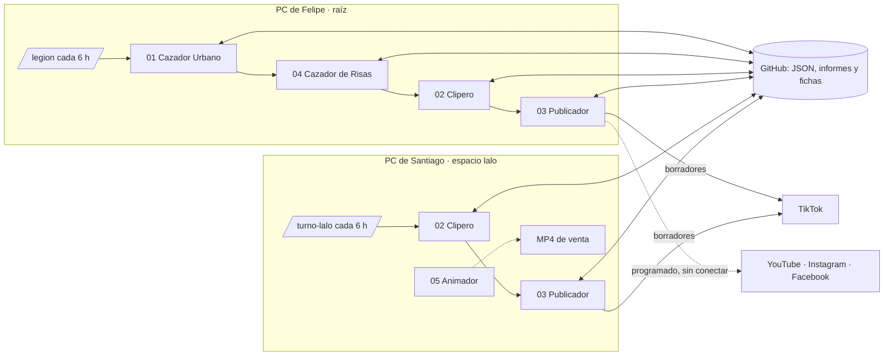

# Arquitectura

Versión 1 · 2026-11-19. Primero lo que hay (detalle en `AS_IS.md`), después Mission Control v0 y el camino a una v1. Regla del brief: reutilizar lo que funciona; no reconstruir.

## 1. Lo que hay

- **Orquestación:** Claude Code en cada PC. Una skill (`.claude/skills/`) lanza un subagente (`.claude/agents/`) que usa scripts de PowerShell (`legion/NN-*/`).
- **Datos:** archivos JSON en el repositorio. GitHub es el bus entre las dos PCs. Cada agente escribe solo su memoria (`datos/`) y sus entregables (`salidas/`).
- **Medios:** los videos se quedan en la PC que los corta (no viajan por GitHub).
- **Credenciales:** fuera del repositorio, en cada PC (`%USERPROFILE%\.legion\publicador\credenciales.json`).

**Ya cumple con el brief:** solo APIs oficiales, aprobación humana, variantes reales, secretos fuera de Git y un espacio por PC.
**Le falta:** registro de licencias, métricas, medición de costos y un lugar común donde ver todo (Mission Control).

## 2. Mission Control

**Desde el 2026-11-19 la versión en uso es la v1:** https://legion-mission-control.vercel.app (D-10).
- **Hosting:** app Next.js en Vercel (plan Hobby, gratis).
- **Datos:** Postgres de Neon (plan gratis), con tablas `mc_docs` y `mc_audit`.
- **Acceso:** usuario y contraseña para Santiago y Felipe.
- **Agentes:** escriben por la API `/api/agent/...` con el token `MC_AGENT_TOKEN`, guardado en Vercel y en el `.env.local` de la PC.
- **Código:** `mission-control/` (ver su README).

Las pestañas, las colecciones y el flujo de abajo siguen igual que en la v0; solo cambia el paso 2 de «Cómo llega el estado del pipeline». La v0 (página en claude.ai, `docs/mission-control/`) quedó como respaldo y ya no se usa.

| Pestaña | Qué muestra | Quién escribe |
|---|---|---|
| Hoy | Las 3 prioridades del día de cada persona, lo atrasado, lo bloqueado, lo que espera revisión, el resumen del pipeline y las unidades A, B y C | Personas |
| Tareas | Tablero por estado (backlog, ready, in_progress, blocked, review, done, canceled) o lista por semana. Cada tarea lleva responsable, unidad, semana, prioridad, esfuerzo, fecha, dependencias, pasos, criterio de aceptación, evidencia y motivo de bloqueo | Personas y Claude |
| Cuentas | Marcas y cuentas por familia (clips de famosos o propias), con plataforma, nicho, estado, derechos y si están en el piloto | Personas y Claude |
| Pipeline | Por espacio: clips por estado, derechos, publicaciones, aprobaciones pendientes, último ciclo de cada agente y alertas | Claude, al final de cada ciclo |
| Decisiones | Pendientes con opciones y recomendación; tomadas con fecha y responsable | Personas y Claude |

**Colecciones:** `tareas`, `cuentas`, `decisiones` y `pipeline` (un documento por espacio).

**Cómo llega el estado del pipeline** (tarea C5):
1. Al final de `/legion` y de `/turno-lalo`, un script de PowerShell junta los conteos de `clips.json`, `publicaciones.json`, `pendientes.md` y los informes en `salidas/mission-control/<espacio>.json`, que sube a GitHub como cualquier entregable.
2. El script manda ese archivo a Mission Control: `PUT /api/agent/pipeline/<espacio>`, con el token de la PC.
3. Cada PC necesita el token en su `.env.local`, fuera del repositorio. Santiago lo copia a la PC de Felipe sin pasarlo por chat.

**Límites:**
- Solo para los socios: no hay portal de clientes ni roles finos.
- `mc_audit` guarda quién cambió qué y cuándo.
- Los datos viven en Neon. Si se borra la base, se pierden; la tarea C5 deja además una copia del pipeline en GitHub en cada ciclo.

## 3. Entidades del brief y dónde viven hoy

| Entidad del brief | Hoy | Mission Control v0 |
|---|---|---|
| Task, Dependency, Sprint | `docs/ROADMAP.md` | `tareas` (con `depende` y `semana`) |
| BusinessUnit, Goal | `docs/ESTRATEGIA.md` | Pestaña Hoy (unidades A, B y C) |
| Brand, SocialAccount | `legion/03-publicador/config.json` de cada espacio | `cuentas` |
| Agent, AgentRun | `.claude/agents/*.md` y `salidas/*/informes/` | `pipeline.agentes` (último ciclo) |
| VideoVariant | `salidas/clipero/clips.json` (`variante_de`) | Conteos en `pipeline` |
| PublishingJob | `salidas/publicador/publicaciones.json` | Conteos en `pipeline` |
| MetricSnapshot | `datos/publicador/metricas.json` y `panel.html` | Pendiente (C9) |
| SourceLicense | Campo `derechos` de cada clip, sin evidencia | Registro de licencias (C3 y C8) |
| Budget, Expense, Revenue | No existe | Pendiente (C4 y `COST_MODEL.md`) |
| Lead, Client | No existe | Pendiente (C10) |
| Decision | `docs/DECISIONS.md` | `decisiones` |
| AuditLog | Historial de Git | «Marcada por… el…» en cada tarea |

## 4. Hacia dónde puede crecer Mission Control

La v1 ya está en Vercel con Postgres (§2). Lo que sigue cuando haga falta (portal para clientes de la Unidad B, roles por persona o más volumen):

Cuando haga falta un portal para clientes de la Unidad B, roles por persona o más volumen:
- **App:** Next.js + TypeScript en Vercel.
- **Datos y acceso:** PostgreSQL con autenticación y reglas por fila (Supabase o equivalente), aislando cada cliente.
- **Agentes:** siguen siendo Claude Code en las PCs, más rutinas en la nube; escriben en la base por su API, con una clave guardada fuera del repositorio.
- **Migración:** se exportan las colecciones de la v0 a JSON y se cargan en la base nueva.
- **Necesita aprobación:** cuentas nuevas y gasto mensual (`COST_MODEL.md`).

## 5. Seguridad

- Mission Control es privada. Solo la abren quienes Santiago agrega desde *Compartir*. Ningún dato de clientes va a la v0.
- Ninguna clave entra al repositorio ni a Mission Control.
- Publicar, gastar, crear cuentas o escribir a terceros siempre pasa por aprobación humana (brief §6).
